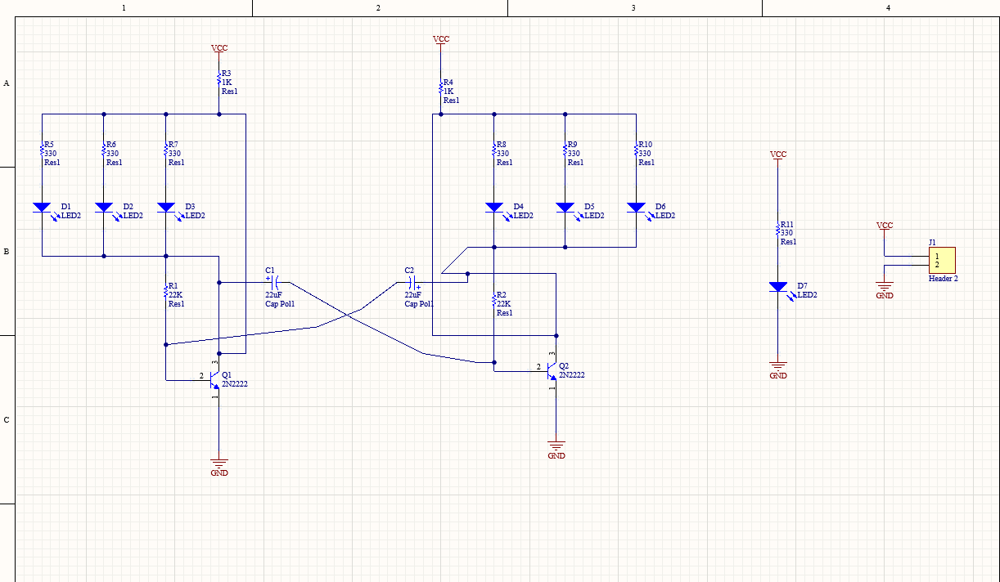
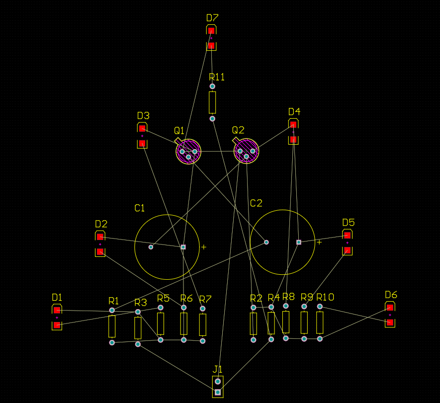
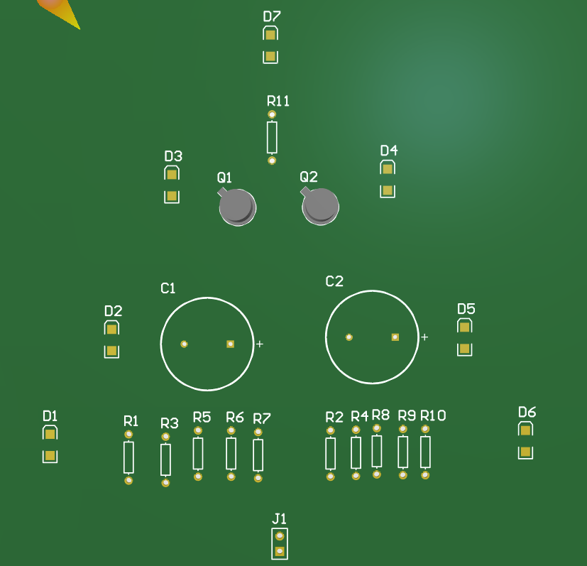

# 🎄 Christmas Tree PCB — Світлодіодна ялинка на симетричному мультивібраторі

Друкована плата декоративного новорічного сувеніра у формі три'ярусної ялинки зі світлодіодною індикацією, спроєктована в **Altium Designer** із підготовкою 3D-моделі для збірки в **Autodesk Fusion**.

---

## 📌 Принцип роботи схеми

В основі пристрою лежить **симетричний астабільний мультивібратор** на двох біполярних NPN-транзисторах `2N2222` (`Q1`, `Q2`):

1. **Автоколивання:** транзистори `Q1` і `Q2` почергово відкриваються та закриваються завдяки перехресному ємнісному зворотному зв'язку через конденсатори `C1`, `C2` (`22 мкФ`) та базові резистори `R1`, `R2` (`22 кОм`).
2. **Частота перемикання:** задається $RC$-ланцюгами ($R_1 C_2$ та $R_2 C_1$) і становить близько **1,5 Гц** (період повного циклу $\approx 0,67\text{ с}$).
3. **Світлодіодна індикація:**
   - **Гірлянда (`D1–D6`):** розділена на дві незалежні групи по 3 світлодіоди (`D1–D3` у колекторному колі `Q1` та `D4–D6` у колі `Q2`), які блимають у протифазі. Кожен світлодіод має індивідуальний струмообмежувальний резистор на `330 Ом` (`R5–R10`).
   - **Верхівка (`D7`):** підключена через резистор `R11` (`330 Ом`) напряму до шини живлення `VCC` і світиться постійно.

---

## 🧩 Перелік елементів (BOM)

| Позначення | Тип компонента | Номінал / Модель | Кількість | Призначення |
| :--- | :--- | :--- | :---: | :--- |
| `Q1, Q2` | Транзистор NPN | `2N2222` | 2 | Ключові елементи мультивібратора |
| `C1, C2` | Конденсатор електролітичний | `22 мкФ` (`Cap Pol1`) | 2 | Часозадавальні конденсатори зв'язку |
| `R1, R2` | Резистор | `22 кОм` | 2 | Базові резистори зміщення |
| `R3, R4` | Резистор | `1 кОм` | 2 | Колекторні навантажувальні резистори |
| `R5–R11` | Резистор | `330 Ом` | 7 | Струмообмежувальні резистори світлодіодів |
| `D1–D6` | Світлодіод SMD | `LED` | 6 | Миготлива гірлянда (2 групи по 3 шт.) |
| `D7` | Світлодіод SMD | `LED` | 1 | Індикатор верхівки (постійне світіння) |
| `J1` | Роз'єм живлення | `Header 2` | 1 | Підключення зовнішнього живлення (`VCC`, `GND`) |

---

## 🛠️ Особливості конструкції та трасування PCB

- **Форм-фактор:** фігурний контур ялинки (`Keep-Out Layer`) із прямокутним стовбуром `18 × 12 мм` у нижній частині для фіксації у підставці.
- **Компонування:** комбінований монтаж — SMD-світлодіоди на верхньому шарі (`Top Layer`) для охайного вигляду лицьової сторони та вивідні (THT) елементи мультивібратора в нижній широкій частині плати.
- **Трасування:** двошарова плата (`Top Layer` — червоний, `Bottom Layer` — синій) із симетричним розміщенням світлодіодів по ярусах для діагонального ефекту перемикання.
- **Підготовка до 3D-збірки:** роз'єм `J1` винесений вище лінії стовбура, щоб уникнути механічного упору в дно паза підставки; плату експортовано у формат `.step`.

---

## 🖼️ Візуалізація проєкту

### 1. Принципова електрична схема

### 2. Розведення друкованої плати (2D)

### 3. Тривимірна модель плати (3D)

---

